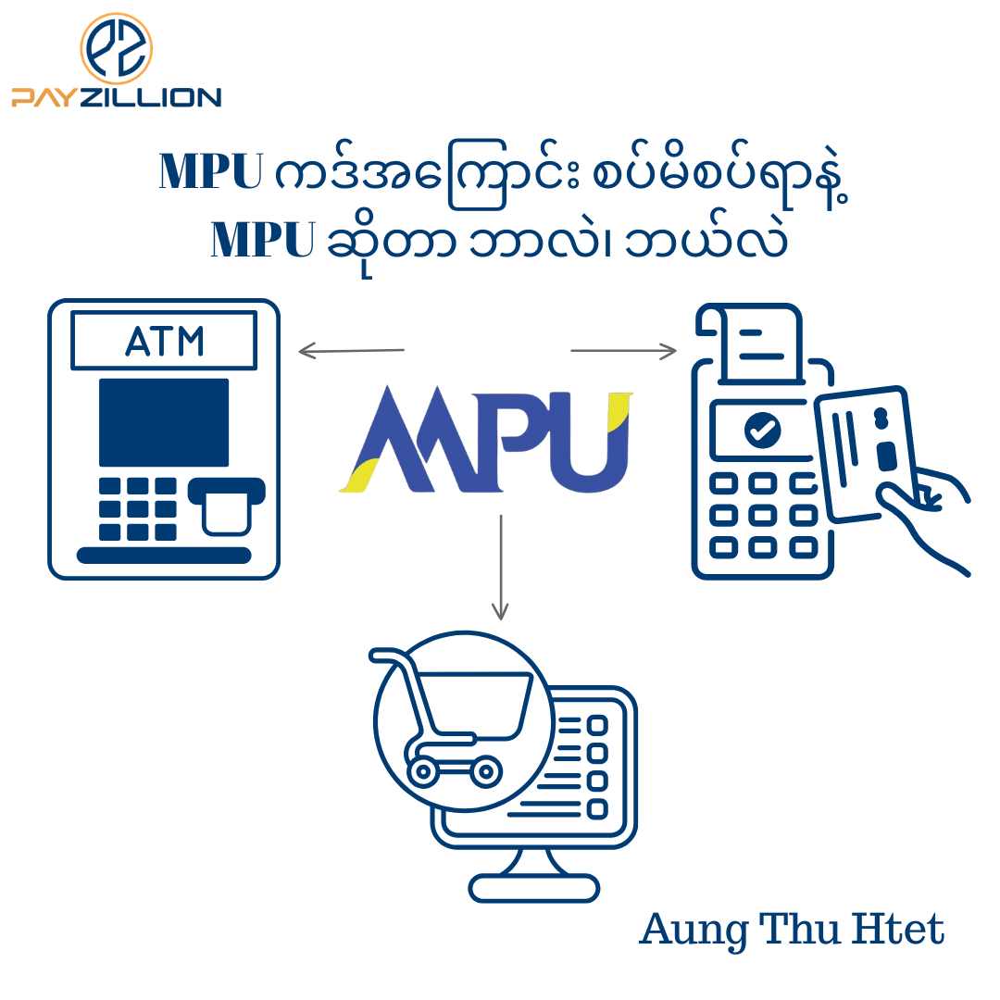

Myanmar Payment Union (MPU) ကို ၂၀၁၁ ခုနှစ်မှာ မြန်မာနိုင်ငံတော်ဗဟိုဘဏ်ရဲ့ ဦးဆောင်မှုနဲ့ စတင်ဖွဲ့စည်းခဲ့တာပါ။ MPU ရဲ့ အဓိက လုပ်ဆောင်ချက်ကတော့ National Payment Switch (NPS) အနေနဲ့ ကဒ်ကွန်ရက် (Card Network) ကို ထောက်ပံ့ပေးတာပါ။ MPU ကြောင့် မြန်မာပြည်တွင်းဘဏ်တွေက ထုတ်ဝေတဲ့ ကဒ်တွေဟာ မတူညီတဲ့ ဘဏ်တွေရဲ့ ATM ၊ POS စက်တွေ၊ E-commerce website နဲ့ app တွေမှာ အသုံးပြုငွေပေးချေလို့ရတာ ဖြစ်ပါတယ်။ MPU လို National Payment Switch သာ မရှိခဲ့ရင် ပြည်တွင်းဘဏ်ကဒ်တွေဟာ သက်ဆိုင်ရာ ကဒ်ထုတ်ဝေထားတဲ့ ဘဏ်ရဲ့ စက်တွေမှာသာ အသုံးပြုနိုင်မှာဖြစ်ပြီး Interoperability လို့ခေါ်တဲ့ မတူညီတဲ့ ဘဏ်တွေ၊ စနစ်တွေမှာ အသုံးပြုနိုင်မှာ မဟုတ်ပါ။

MPU ဟာ ၂၀၁၃ခုနှစ်မှာ နိုင်ငံတကာကဒ်ကွန်ရက်တွေဖြစ်တဲ့ UPI ၊ JCB တို့နဲ့ Card Network level collaboration တွေပြုလုပ်နိုင်ခဲ့ပြီး နိုင်ငံတကာက UPI နဲ့ JCB ကဒ်တွေကို MPU ကွန်ရက်မှာ စတင်လက်ခံနိုင်လာပါတယ်။ MPU ဟာ ၂၀၁၅ ခုနှစ်မှာ Public Company အဖြစ် ပြောင်းလဲဖွဲ့စည်းခဲ့ပါတယ်။ ၂၀၁၅ ခုနှစ်မှာပဲ 2C2P ရဲ့ စနစ်ထောက်ပံ့မှုနဲ့ MPU ကဒ်တွေအတွက် ပြည်တွင်း အွန်လိုင်းငွေပေးချေမှု e-commerce ဝန်ဆောင်မှုကို စတင်မိတ်ဆက်ခဲ့ပါတယ်။ ပြည်တွင်းကဒ်စနစ်တွေအတွက် ကဒ်ကွန်ရက်တစ်ခုအဖြစ် စတင်ခဲ့တဲ့ MPU ဟာ ၂၀၁၆ ခုနှစ်မှာတော့ နိုင်ငံတကာကို ယူဆောင်အသုံးပြုနိုင်တဲ့ MPU-UnionPay Co-Brand Card တွေ၊ MPU-JCB Co-Brand Card တွေလည်း ဘဏ်တွေကို ထုတ်ဝေနိုင်အောင် လုပ်ဆောင်ပေးခဲ့ပါတယ်။ ၂၀၂၄ ခုနှစ်မှာ Mastercard နဲ့ ပူးပေါင်းထုတ်ဝေတဲ့ MPU-Mastercard Co-Brand Card တွေလည်း ထွက်လာခဲ့ပါတယ်။ ကဒ်ကွန်ရက်အချင်းချင်း ပူးပေါင်းလုပ်ဆောင်မှုကြောင့် ပြည်တွင်းဘဏ်တွေက ထုတ်ဝေတဲ့ MPU Co-Brand Card တွေဟာ နိုင်ငံတကာကို ယူဆောင်သွားလို့ရလာပြီး UPI ၊ JCB ၊ Mastercard လက်ခံတဲ့ ATM တွေ၊ POS စက်တွေနဲ့ e-commerce စနစ်တွေမှာ အသုံးပြုလို့ရလာပါတယ်။

ဘဏ်တွေက MPU ကဒ်တွေထုတ်ဝေရာမှာ ပြည်တွင်းမှာပဲ အသုံးပြုနိုင်တဲ့ MPU သီးသန့်ကဒ်တွေ ထုတ်ဝေကြသလို၊ နိုင်ငံတကာကို ယူဆောင်သွားလို့ရတဲ့ MPU Co-Brand ကဒ်တွေရော ထုတ်ဝေကြပါတယ်။ MPU brand အောက်မှာ Credit Card နဲ့ Debit Card ဆိုပြီး ကဒ်အမျိုးအစား နှစ်မျိုး ထုတ်ဝေကြပါတယ်။ အဲ့ဒါကြောင့် ဘဏ်တွေမှာ ကဒ်လျှောက်ထားတဲ့အခါ ကိုယ်အသုံးပြုချင်တဲ့ ရည်ရွယ်ချက်ပေါ်မူတည်ပြီး လျှောက်ထားသင့်ပါတယ်။ ပြည်တွင်းမှာပဲ သီးသန့်အသုံးပြုချင်တာဆိုရင် MPU သီးသန့်ကဒ် ကိုင်ဆောင်ဖို့ အဆင်ပြေပါတယ်။ နိုင်ငံခြားကို ယူသွားပြီး အသုံးပြုမှာဆိုရင် အိမ်နီးချင်းအာရှနိုင်ငံတွေပဲ သွားမှာဆိုရင် ဘယ် MPU Co-Brand Card ကိုမဆို ကိုင်ဆောင်နိုင်ပြီး အနောက်နိုင်ငံတွေအထိ သွားမှာဆိုရင်တော့ MPU-Mastercard (Co-Brand) က ပိုပြီး အဆင်ပြေနိုင်ပါတယ်။ (ဒီနေရာမှာ Visa Card တွေကိုလည်း ထည့်သွင်းစဉ်းစားနိုင်ပါတယ်။ နိုင်ငံတကာအတိုင်းအတာမှာ ဘယ်ကိုရောက်ရောက် အသုံးပြုနိုင်ဖို့ သေချာတာမို့ပါ။ Visa ကဒ်ကတော့ MPU နဲ့ Co-Brand မထုတ်ထားသေးပါ။ ဘဏ်တွေက သူတို့အစီအစဉ်နဲ့သူတို့ ထုတ်ဝေကြပါတယ်။) နောက်ပြီး ကဒ်လျှောက်ထားရာမှာ Credit Card တွေမှာဆို Card ရဲ့ level နဲ့ brand အမျိုးအစားပေါ်မူတည်ပြီး Travel Perks နဲ့ Reward တွေခံစားခွင့်ရှိတာမို့ နိုင်ငံခြားမကြာခဏထွက်တတ်တဲ့သူဆိုရင် Debit Card အသုံးပြုတာထက် Credit Card လျှောက်ထားအသုံးပြုတာက ပိုအဆင်ပြေနိုင်ပါတယ်။ Credit Card တွေမှာလည်း Platinum တို့ Diamond တို့ ကိုင်ဆောင်မယ်ဆို အကျိုးခံစားခွင့်တွေ အများဆုံးရမှာဖြစ်ပါတယ်။ (ကဒ်အတွက် နှစ်စဉ်ကြေးလဲ အများဆုံး ပေးရမှာပါနော်။)

MPU Card ကိုင်ဆောင်ရာမှာ ATM နဲ့ POS စက်တွေမှာ အသုံးပြုနိင်ဖို့အတွက် ကဒ် activate လုပ်ပြီးတာနဲ့ စတင်အသုံးပြုနိုင်မှာပေမယ့် ပြည်တွင်း e-commerce စျေးဝယ်ရာမှာ အသုံးပြုဖို့အတွက်တော့ သီးသန့်လျှောက်ထားဖို့လိုပါတယ်။ အချို့ဘဏ်တွေမှာတေ့ ကဒ်လျှောက်တာနဲ့ တစ်ခါတည်း e-commerce အသုံးပြုနိုင်အောင် စီစဉ်ပေးလိုက်တာရှိနိုင်ပေမယ့် များသောအားဖြင့် ကိုယ်တိုင်လျှောက်ထားရပါမယ်။ လျှောက်ထားရမယ့် Link ကတော့ [https://www.mpu-ecommerce.com/Payment/OnlineEnrollment/Check](https://www.mpu-ecommerce.com/Payment/OnlineEnrollment/Check) ဖြစ်ပါတယ်။ လျှောက်ထားတဲ့အခါ သက်ဆိုင်ရာဘဏ်တွေက application ကို စစ်ဆေးပြီး manual approval ပေးမှာဖြစ်လို့ ရက်အနည်းငယ်စောင့်ရတာမျိုးရှိမှာပါ။ အကယ်၍ ကိုယ့်ရဲ့ MPU ကဒ်က KBZ Bank သို့မဟုတ် AYA Bank က ထုတ်ဝေထားတာဆိုရင်တော့ KBZ နဲ့ AYA ရဲ့ ကိုယ်ပိုင် e-commerce application portal ကနေ လျှောက်ထားရမှာပါ။ အဲ့ဒါဆိုရင်တော့ MPU portal မှာလို အချိန်မစောင့်ရဘဲ ချက်ချင်း (Real-Time) စတင်အသုံးပြုနိုင်မှာ ဖြစ်ပါတယ်။ လျှောက်ထားရမယ့် Link တွေကတော့ KBZ Bank ဆိုရင် [https://mpu-ecommerce.kbzbank.com](https://mpu-ecommerce.kbzbank.com) ဖြစ်ပြီး AYA Bank ဆိုရင် [https://card.ayabank.com](https://card.ayabank.com) ဖြစ်ပါတယ်။ ဘဏ်ရဲ့ application portal ဆိုပေမယ့် MPU ရဲ့ ecommerce စနစ်ဆီကို ချိတ်ဆက်ထားပြီး Email ၊ OTP နဲ့ လျှောက်ထားသူရဲ့ အချက်အလက်တွေကို system နဲ့ auto verify လုပ်ပြီး approval ပေးတာမို့ ချက်ချင်းရတာဖြစ်ပါတယ်။ MPU Co-Brand ကဒ်တွေအတွက် ပြည်တွင်းမှာ e-commerce အသုံးပြုနိုင်ဖို့ သီးသန့်လျှောက်ရပေမယ့် UPI ၊ JCB ၊ Mastercard လို နိုင်ငံတကာ ငွေပေးချေမှုကွန်ရက်နဲ့ အသုံးပြုမယ့် International e-commerce အသုံးပြုနိုင်ဖို့အတွက်တော့ သီးသန့်လျှောက်ထားစရာမလိုပါ။ ကဒ်လက်ထဲရောက်ပြီး activation ပြုလုပ်ပြီးတာနဲ့ international e-commerce ready ဖြစ်ပါတယ်။

MPU Debit Card တွေနဲ့ ပြည်တွင်း ATM မှာ ငွေထုတ်မယ်ဆိုရင် တစ်ရက်မှာ အများဆုံး ၁၀သိန်းထိ ထုတ်ယူလို့ရပါတယ်။ ပြည်တွင်း POS စက်နဲ့ e-commerce စျေးဝယ်တာတွေမှာဆိုရင် တစ်ရက်မှာ အများဆုံး သိန်း၅၀အထိ အသုံးပြုနိုင်ပါတယ်။ Inter Bank Fund Transfer အတွက်ကတော့ အများဆုံး သိန်းတစ်ရာအထိ ငွေလွှဲနိုင်ပါတယ်။ ဒါကယျေဘုယျအားဖြင့် ပြည်တွင်းမှာ အသုံးပြုနိုင်တဲ့ (Limit) သတ်မှတ်ချက်တွေ ဖြစ်ပြီး အချို့ဘဏ်တွေမှာ ပိုပြီး ကန့်သတ်ထားတာတွေ ရှိနိုင်ပါတယ်။ နိုင်ငံတကာက ATM နဲ့ POS စက်တွေမှာဆိုရင်တော့ သက်ဆိုင်ရာဘဏ်အလိုက် သတ်မှတ်ချက်တွေ မတူညီကြပါ။ ဘဏ်အလိုက် Oversea Transaction Fee တွေ၊ Fx Mark Up Fee တွေလည်း ပေးရမှာဖြစ်ပါတယ်။

ဒီလောက်ဆိုရင်တော့ MPU အကြောင်း၊ MPU ကဒ်တွေ အကြောင်း၊ ကန့်သတ်ချက် (Limit) တွေကို ရှင်းရှင်းလင်းလင်း သိသွားလောက်ပါပြီ။ အဆင်ပြေကြမယ်လို့ ယုံကြည်ပါတယ်။ ငွေပေးချေမှုတွေအကြောင်း သိစရာတွေဖတ်ဖို့အတွက် Payment Essentials စာအုပ်ကို [https://payzillion.com/payment-essentials](https://payzillion.com/payment-essentials) မှာ အခမဲ့ download ရယူနိုင်ပါပြီ။ မကြာခင်မှာ Card Payment စနစ်တွေအကြောင်း အသေးစိတ်ရေးထားမယ့် Card Payments Professional စာအုပ်လည်း ထွက်လာဖို့ရှိပါကြောင်းလည်း သတင်းကောင်းပေးပါတယ်။
